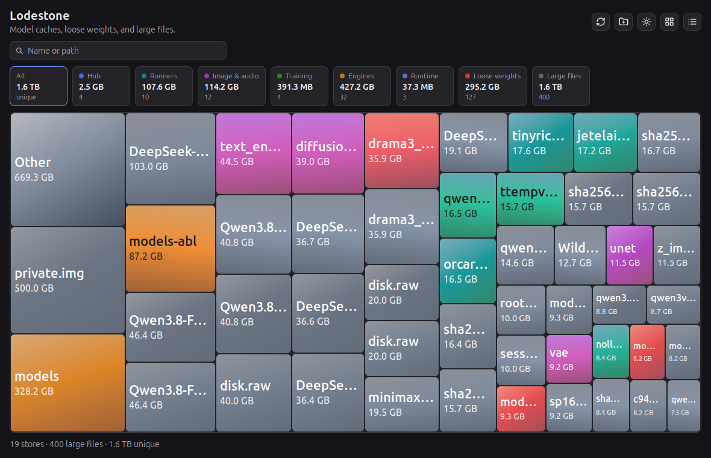
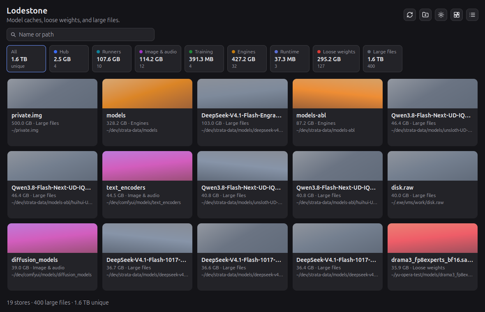
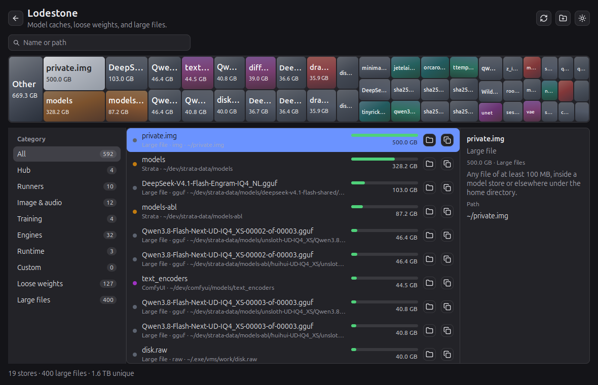

# Lodestone

A native window for the model files already on disk. It catalogs hub caches, runner stores, image and audio tools, training checkouts, engines, runtimes, loose weight files, and other large files under your home directory, then shows them by name, path, and category.

The window is [MyGo](https://mygo.egoist.dev) native UI. There is no web page and no webview.

## Snapshots







## Run

Needs Go 1.27.

```sh
go run .
```

`go test` covers the scan, the map math, and the window.

## Install

A tag `v0.1.1` publishes the installers. Pick the one for your machine from the [releases](https://github.com/jstdlee/lodestone/releases).

| System | File | Install |
| --- | --- | --- |
| macOS M series | `lodestone-0.1.1-arm64.dmg` | Open the disk image and drag Lodestone to Applications |
| Windows x64 | `lodestone-setup-0.1.1-amd64.exe` | Run the installer. It installs for the current user |
| Linux x64 | `lodestone_0.1.1_amd64.deb` | `sudo apt install ./lodestone_0.1.1_amd64.deb`, then `lodestone` |
| Linux ARM64 | `lodestone_0.1.1_arm64.deb` | `sudo apt install ./lodestone_0.1.1_arm64.deb`, then `lodestone` |
| Linux, either | `lodestone-0.1.1-linux-amd64.tar.gz`, `lodestone-0.1.1-linux-arm64.tar.gz` | Unpack and run `./install.sh`. It installs for the current user and adds `~/.local/bin/lodestone` |

The Linux packages depend on GTK 3 only. The app draws its own window, so WebKitGTK is not required. The builds are not signed: Gatekeeper on another Mac, and SmartScreen on Windows, will warn.

## The window

The window opens on the map. Category totals sit above it. Search, under the title, matches a name or a path and filters the map, the gallery, and the list together.

The icons at the right are rescan, custom directories, and the theme. The theme follows the system the first time the window opens, then the sun and moon icons switch it. The gallery and details icons sit with them.

### Map

Block area follows the log of each file's size relative to the smallest file shown: twice the bytes is about twice the area, and a thousand times the bytes is about eleven times the area. The number on the block is the real size, and the type scales with the block. Each block is a diagonal gradient of its category's colors, and neighboring blocks of the same category are shifted so they do not share one flat fill.

The first 48 files are drawn. The rest collapse into Other.

### Gallery

The gallery icon replaces the map with a card for every row in the current filter, including files the map folded into Other. The map icon returns to the treemap.

A card is the category gradient, then the name, the size and category, and the path with your home shortened to `~`. Click a card to select it. The chosen card shines and the others dim, the same pulse as a chosen map block. Rest the pointer on a card for the full file name and path.

An empty scan says "Nothing to show". A search with no hits says "No matches".

### Details

The list icon opens the category list. Pick a row to read its path, reveal it in the file manager, or copy the path. The same row lights up on the map, and a block opens that row. The folder icon shows the file in the file manager. The copy icon copies the path.

### Selection

The chosen block shines and the others dim. The shine pulses down to a dim and back up, with no border. After the pulse it stays bright. Cards in the gallery use the same shine and dim.

### Tips

Rest the pointer on a map block, a gallery card, a list row, or a truncated detail (name, path, layout, environment, note) for 400ms. The tip shows the full file name and the full path, and it stays beside the pointer as the pointer moves. Near the right or bottom edge it flips to the other side of the pointer so it stays in view. A button's own tip, such as Show in folder, wins while the pointer is on that button.

## Custom directories

The directories icon opens a list you keep. Add starts a path, duplicate copies one into that path so you can change it, and delete arms a removal. The check confirms the add, the copy, or the removal. The folder icon on the draft chooses a directory. The list is saved in the Lodestone config directory and scanned with the built-in caches. A path already inside another store is shown, but its bytes stay in the unique total once.

## What the numbers mean

The scan lists a place only when that directory or file exists. The total is unique bytes: a hub blob that also shows up as a large file is counted once. A category total is the listed size of that group, which can overlap. Symlinks are not followed into a second copy of the same file. Environment variables win over the default path, and a leftover default is still listed when it exists so an old cache is not invisible.

Loose weights are files outside a known store of at least 64 MB whose extension is `.safetensors`, `.gguf`, `.ggml`, `.pt`, `.pth`, `.ckpt`, `.onnx`, `.sft`, `.engine`, `.plan`, or `.ot`, plus a `.bin` that is at least 200 MB and not executable. Large files are anything of at least 100 MB under the home directory, including files already inside a store.

## Catalog

Order matters. A later pattern that resolves to a path already measured is marked shared instead of counted again. MLX, TensorFold, and llama.cpp without `LLAMA_CACHE` read the Hugging Face hub, so their weights show up there.

| Tool | Category | Where it looks |
| --- | --- | --- |
| Hugging Face Hub | Hub | `HF_HUB_CACHE`, else `$HF_HOME/hub`, else `$XDG_CACHE_HOME/huggingface/hub`, else `~/.cache/huggingface/hub` |
| Hugging Face Xet | Hub | `HF_XET_CACHE`, else `$HF_HOME/xet`, else `~/.cache/huggingface/xet` |
| Hugging Face assets | Hub | `HF_ASSETS_CACHE`, else `$HF_HOME/assets`, else `~/.cache/huggingface/assets` |
| Hugging Face datasets (legacy) | Hub | `HF_DATASETS_CACHE`, else `$HF_HOME/datasets`, else `~/.cache/huggingface/datasets` |
| Transformers (legacy) | Hub | `TRANSFORMERS_CACHE`, else `$HF_HOME/transformers`, else `~/.cache/torch/transformers` |
| ModelScope | Hub | `MODELSCOPE_CACHE`, else `~/.cache/modelscope` |
| Ollama | Runners | `OLLAMA_MODELS`, else `~/.ollama/models`, plus `/usr/share/ollama/.ollama/models` |
| LM Studio | Runners | `downloadsFolder` in `~/.lmstudio/settings.json`, else `~/.lmstudio/models`, plus `~/.cache/lm-studio/models` |
| llama.cpp | Runners | `LLAMA_CACHE`, else `~/.cache/llama.cpp`. With neither set, it uses the hub |
| GPT4All | Runners | `~/.local/share/nomic.ai/GPT4All` |
| Jan | Runners | `~/.local/share/Jan`, plus `~/jan/models` |
| Open WebUI | Runners | `~/.open-webui`, plus `~/.local/share/open-webui` |
| LocalAI | Runners | `LOCALAI_MODELS_PATH`, else `~/LocalAI/models`, plus `~/.local/share/localai/models` |
| KoboldCpp | Runners | No store. The weight is the file passed to `--model`, and it shows up under loose files |
| text-generation-webui | Runners | `~/text-generation-webui/models` |
| ComfyUI | Image & audio | An install's `models/` and `base_path` entries in `extra_model_paths.yaml`, plus `~/ComfyUI/models` and `~/comfy/models` |
| Stable Diffusion webui | Image & audio | `~/stable-diffusion-webui/models`, or another install's `models/` found on disk. Checkpoints sit in `models/Stable-diffusion` |
| InvokeAI | Image & audio | `INVOKEAI_ROOT/models`, else `~/invokeai/models` |
| Fooocus | Image & audio | `~/Fooocus/models` |
| Whisper | Image & audio | `~/.cache/whisper` (`.pt`). faster-whisper uses the hub |
| PyTorch | Image & audio | `TORCH_HOME`, else `$XDG_CACHE_HOME/torch`, else `~/.cache/torch` |
| EasyOCR | Image & audio | `~/.EasyOCR/model` |
| PaddleOCR | Image & audio | `~/.paddleocr` |
| FastEmbed | Image & audio | `FASTEMBED_CACHE_PATH`, else `~/.cache/fastembed` |
| Unsloth studio cache | Training | `~/.unsloth/studio/cache`. Linked blobs are not counted twice |
| Unsloth legacy hub | Training | `~/.unsloth/studio/cache/huggingface/hub` |
| Unsloth studio outputs | Training | `studio/{outputs,exports,compiled_cache}`. The bundled Node runtime is not scanned |
| Unsloth llama.cpp | Training | `~/.unsloth/llama.cpp`. A toolchain, not a weight store |
| TensorFold | Engines | Checkpoints land in the hub. Kits and abliteration workdirs are `tensorfold-*` beside that hub. Spilled prompt state is `~/.cache/tensorfold/spilled` |
| Strata | Engines | `STRATA_MODELS_DIR` or `STRATA_DATA_DIR`, else `data_dir` in `$XDG_CONFIG_HOME/strata/settings.json`, else `~/Documents/Strata/Models` |
| Strata components | Engines | `STRATA_COMPONENTS_DIR`, else `~/.local/share/strata/components`. Binaries, not weights |
| MLX | Engines | The hub. A private `~/.cache/mlx` is listed only if something created it |
| vLLM | Runtime | `VLLM_CACHE_ROOT`, else `~/.cache/vllm`. Weights come from the hub |
| SGLang | Runtime | `~/.cache/sglang` when one has been written |
| Triton | Runtime | `TRITON_CACHE_DIR`, else `~/.triton` |
| MLC LLM | Runtime | `~/.cache/mlc_llm` |
| NVIDIA NIM | Runtime | `~/.cache/nim` |
| OpenVINO | Runtime | `~/.cache/openvino` |
| Pinokio | Runtime | `~/pinokio`, with each app under `api/<app>` |

Hub repos are folders named `models--org--name` (or `datasets--`, `spaces--`). The bytes live in `blobs/`. `snapshots/` are symlinks to those blobs, so a snapshot is not a second copy. Ollama is the same idea: `blobs/` plus a manifest per tag.

## Releases

The version is `version` in `mygo.json`. Run the Release workflow from the Actions tab. It tags `v` plus that version, when the tag is missing, then builds and publishes the release. `v0.1.1` matches `"version": "0.1.1"`. Any other tag fails before it builds. Pushing the tag yourself publishes the same way.

The release is four builds: macOS on Apple silicon (M series), Windows x64, Linux x64, and Linux ARM64. Each upload is the disk image, the installer, or the Debian package and archive for that machine.

## Tests

```sh
go test
```
